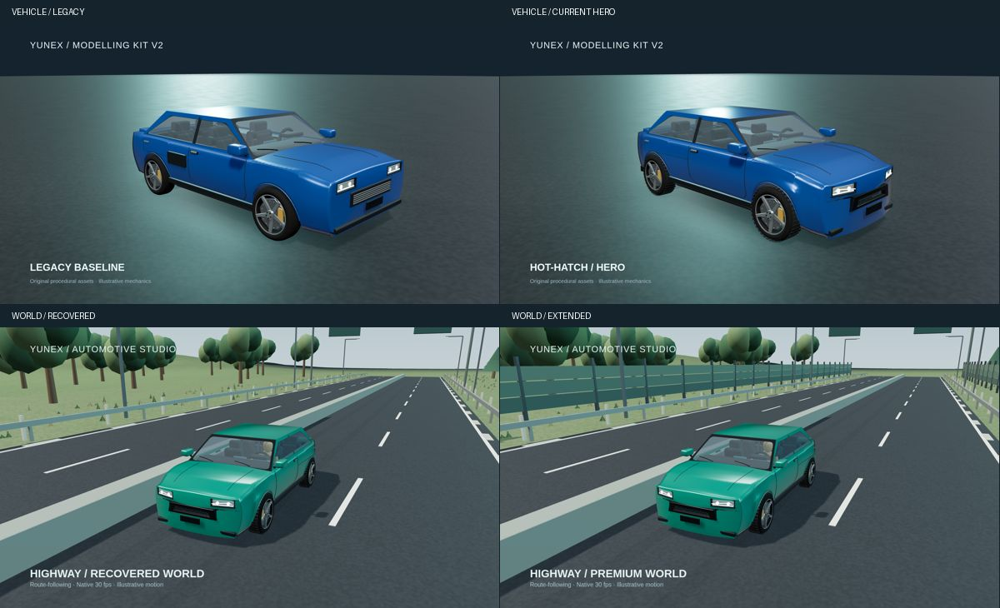

# Premium studio upgrade — verified handoff

Implementation: `656dd0c0672ec586340e120ab272486bfe6c55af`.
Recovered baseline: `b2b2afeb35f081717658bf77f61b66845b52e4ce`.
Continues existing draft PR #233, without EP003/EP004 or legacy-factory changes.

## Verified checks

- 119 tests passed, zero failures, locally and in GitHub: all 105 recovered
  regressions preserved plus 14 new tests. TypeScript passed.
- Eleven GLB exports and round-trip checks passed; geometry/performance report
  retained with workflow artifacts. These are baked poses, not portable rigs.
- [Composition review passed](https://github.com/YunRah2103/Remotion-gpt-chat/actions/runs/39700360349).
- [Native workflow passed](https://github.com/YunRah2103/Remotion-gpt-chat/actions/runs/39700360543):
  all 20 native H.264/yuv420p MP4 jobs and aggregate decode/motion/colour checks.
- Every source clip is 1920×1080 or 1080×1920 at 30fps. The verified pack contains
  3,660 decoded frames, all distinct in the movement sampling region.
- Downloaded the aggregate pack and matched every MP4 SHA256 to its verification
  report. Inspected sequential decoded frames from all A–I landscape/portrait
  videos and both baselines; checked vehicle visibility, driver movement,
  fitted internals, camera clearance and road placement. B retains intentional
  wheel close-ups. Formula cutaway views intentionally expose internal geometry.
- First-frame colour regression: mean absolute RGB error 2.549, below threshold 4.
- Portrait showcase is a lossless container concatenation of native A/D/E/F/G/H/I
  clips: 45 seconds, 1,350 frames, 1080×1920/30fps; full FFmpeg decode passed.
  It is a silent development showcase, not an episode master.

## Visual corrections made during review

Recovered first-stage videos exposed motorway-median obstruction and excessive
night fill. Changed the tracking side and lighting. Subsequent review found the
city camera behind an awning and briefly inside tree crowns; moved its view into
an open road corridor and added a dense 60-position, two-aspect ray regression.
Final moving review keeps the subject visible. Independent code review found
hidden grille slats resurrected by batching; the batcher now skips invisible
sources and a default-optimization regression covers it.

The shell keeps interpolated surface normals through the sculpt transform and
restores them after a damage seek. Original body-surface faceting still exists;
this is not a completed high-end body retopology pass.

## Downloads and comparisons

[All 20 MP4s, stills, before/after exterior images and QA reports](https://github.com/YunRah2103/Remotion-gpt-chat/actions/runs/39700360543/artifacts/12393981005)

The A artifact also contains matching before/after images of all three heroes.
`KitWorldBefore` and `KitF` compare the same car/camera/animation with the original
world and added cinematic dressing, respectively. A's vehicle comparison uses
the preserved legacy vehicle factory and the current hero factory.

Pack SHA256: `c84e763aad620e80fd3b17851bd1f674b939d1acf1fdf6f561a2f8325bdc8bfe`.
Showcase SHA256: `0c74a57a5d9353c8030ba9e7f3fe7022e5867eab9a3472f7837280b9fb1b859c`.

## Production use and remaining scope

Use the [studio API guide](PREMIUM-STUDIO-UPGRADE.md) and existing
[agent quick start](AGENT_QUICKSTART.md). Pick the vehicle, world, driver, action
and route-relative camera; inspect each final shot before using it in an episode.
The tyre-failure system is preserved, but the new review scenes focus on general
acceleration, city/mountain driving, driver operation and Formula circuit action.

This is a verified additive upgrade, not premium approval of all 35 vehicles or
an overhaul of every environment. Individual truck/SUV sculpting, vehicle-specific
diesel/turbo plumbing, more detailed upholstery, passengers/motorcycle riders,
elevated roads, realistic fluid/spray/reflection systems and advanced collision
simulation remain unfinished. Mechanical/human motion is illustrative kinematics.
The camera API is not an arbitrary obstacle-avoidance solver.

Original road geometry, route functions, compatibility, existing internals and
separate episode productions remain intact. PR stays draft and unmerged.
