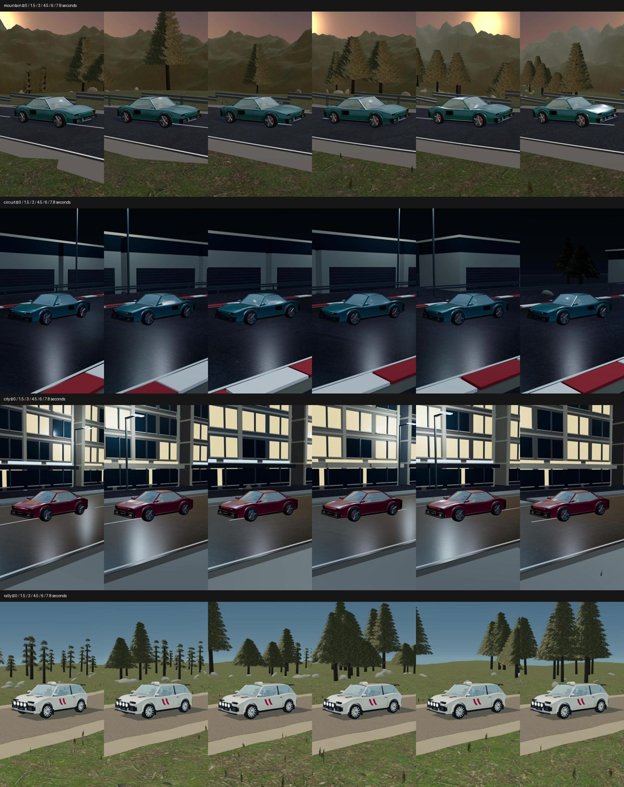
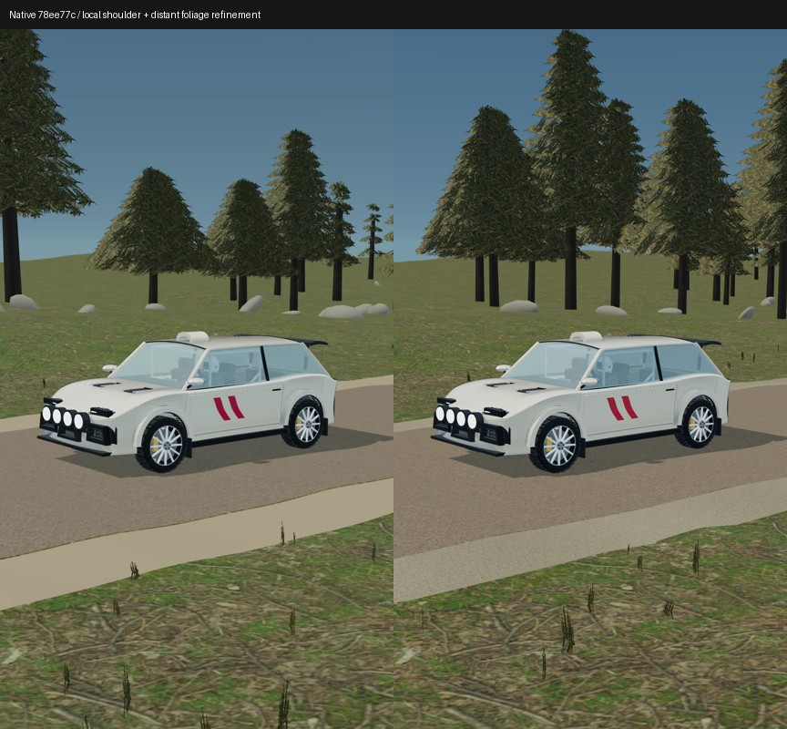

# V5 moving-video review — 23 October 2026

This is an honest intermediate review, **not flagship visual approval**. All four mandatory-format movies now exist, but the complete owner brief is not yet delivered. Keep PR #277 draft and do not merge based solely on technical checks.

## Frozen native evidence

PR head `78ee77cf081e12a1e477087a0b6472d990267200`; actual Actions merge checkout `76c97bf5c1011646e217648c0809c70c05d69700`. Both have tree `1889e28b959e931512fca039d3b2e3e63175592a`.

[Native GitHub Actions run](https://github.com/YunRah2103/Remotion-gpt-chat/actions/runs/40004862150): regression and all four movie jobs succeeded. This exact revision passed 280 Node tests, 9 Python tests and TypeScript. The preserved-baseline test hashes the actual bytes of all 104 original kit source files; catalogue regression covers the original 36 vehicles and 20 environments.

| Movie | Artifact ID | Format |
|---|---|---|
| Mountain | 12525089744 | 1080×1920, 30fps, 240 frames / 8 seconds |
| Circuit | 12525163810 | same |
| City | 12525352786 | same |
| Rally | 12525567245 | same |

Each downloaded movie was independently counted with ffprobe and fully decoded with ffmpeg. All 240 decoded frame hashes are unique in each movie. Exact movie SHA256 values are in [native-verification-78ee77c.json](native-verification-78ee77c.json). Uniqueness is a basic motion check, not proof of attractive camera work or correct contact.

The mountain artifact also includes `controlled-surfaces-ab.mp4`: left procedural fallback versus right scanned road/ground maps. Road, vehicle, lighting, camera and foliage alpha are fixed. This is a surface comparison, **not** a complete V4-versus-V5 comparison.

## Visual findings

Reviewed decoded frames across 0–7.8 seconds per drive; full decode additionally checks corrupt/truncated streams. No claim of full real-time video playback review. Vehicles remain readable, scenery moves, and sampled tyres appear grounded. Independent road-mesh raycasts test wheel contact across the rough-road proof to a 2mm tolerance; this is deterministic cinematic motion, not a physically calibrated simulation.

- Mountain: continuous landscape and atmospheric layering, but terrain remains stylized and the shoulder is too uniform.
- Circuit: readable teal car, reflected light pools and visible kerbs; facilities remain sparse and modular.
- City: wet-looking surface and usable driving composition; façades are visibly repetitive and need authored variation.
- Rally: gravel movement and clearer foliage than the original primitive trees; distant LOD has sparse silhouettes and the landscape needs more convincing ecological composition.

## Follow-up checkpoint

The opt-in authored Khronos Car Concept now has a source-preserving wheel adapter, stationary brake pads, attribution and a separate native moving-video workflow. Its cohesive body/interior is an asset import, not a new procedural supercar model. The approved teal V4 car remains untouched. Native authored-car proof is pending review, so do not claim it visually approved.

Local shoulder refinement adds a granular, varying verge cross-section and terrain-matching outer edge. Distant foliage gets more branch tiers. The paired image below compares the frozen native frame with this local refinement. A still is not sufficient to approve it for final use; require a moving proof and performance review before integrating.

Unfinished owner requirements include materially better class-distinct performance/rally geometry, exceptional flagship scenery, robust obstruction-aware cinematography, broader high-level shot authoring, and completed before/after moving visual approval. Formula is optional after the first three upgraded vehicle classes; those prerequisites are not yet met.

The subsequent agent-camera checkpoint passed all **289 local Node regression tests**, the nine Python tests and TypeScript. All five committed example JSON files passed the actual CLI validator. Review caught and fixed the CLI create/validate round-trip failure, invalid road inputs passing validation, and nonboolean preview flags. Structured camera defaults are tested against the previous tracking trajectory. The terrain placement callback now interpolates the actual visible grid triangles; raycasts verify it between vertices. These are technical findings, not an upgrade of the visual acceptance decision above.
